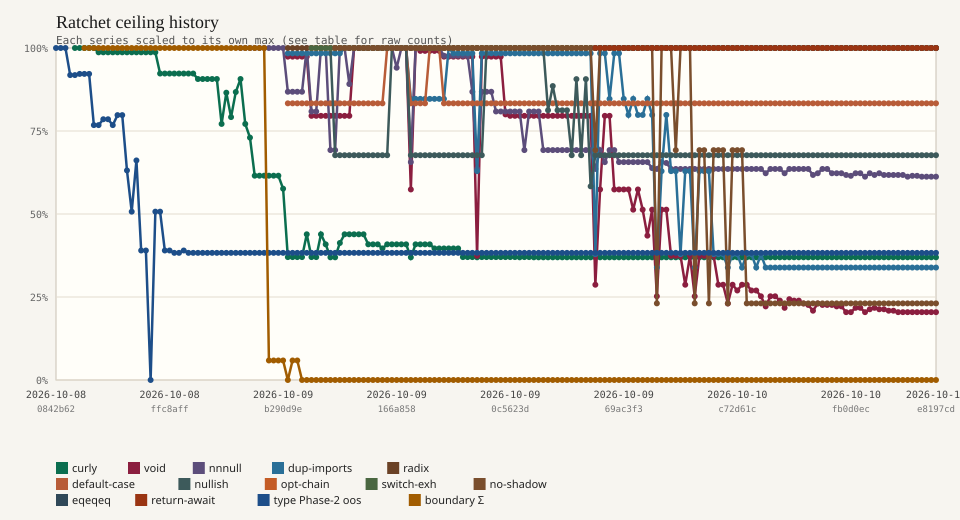

# Ratchet ceiling history

Task: `q-mp-074` / refresh `q-mp-236` / `q-mp-290` / `q-mp-1289`. Generated `2026-10-11T12:33:54.747Z` via `git log --all`.

Tracks report-only ceilings over git history:

- **lint (12): curly / void / nnnull / dup-imports / radix / default-case / nullish / opt-chain / switch-exh / no-shadow / eqeqeq / return-await** — `docs/dev/lint-ratchet-ceilings.json` → `rules.*`
- **type Phase-2 out-of-scope** — `docs/dev/type-ratchet-phase2-baseline.json` → `outOfScopeErrors`
- **boundary sum** — `docs/dev/module-boundaries-ceilings.json` → sum of `ceilings.*`

## Live tip snapshot (`6ae10c1`)

| Metric | Ceiling |
| --- | ---: |
| curly | 538 |
| @typescript-eslint/no-confusing-void-expression | 47 |
| @typescript-eslint/no-non-null-assertion | 237 |
| no-duplicate-imports | 42 |
| radix | 6 |
| default-case | 5 |
| @typescript-eslint/prefer-nullish-coalescing | 65 |
| @typescript-eslint/prefer-optional-chain | 21 |
| @typescript-eslint/switch-exhaustiveness-check | 8 |
| @typescript-eslint/no-shadow | 3 |
| eqeqeq | 1 |
| @typescript-eslint/return-await | 3 |

Chart series are normalized independently; raw counts are in the history table.

Chart (each series normalized to its own max):

Regenerate with `npm run report:ratchet-history` (no network; reads local git only).

| SHA | Date | curly | void | nnnull | dup-imports | radix | default-case | nullish | opt-chain | switch-exh | no-shadow | eqeqeq | return-await | type oos | boundary Σ | Subject |
| --- | --- | ---: | ---: | ---: | ---: | ---: | ---: | ---: | ---: | ---: | ---: | ---: | ---: | ---: | ---: | --- |
| `0842b62` | 2026-10-08 | — | — | — | — | — | — | — | — | — | — | — | — | 564 | — | docs: Phase-2 type-ratchet plan + baseline for AI/rules (burn-1007) |
| `cdc52b4` | 2026-10-08 | — | — | — | — | — | — | — | — | — | — | — | — | 564 | — | docs(dev): Phase 2 type-ratchet plan + report-only baseline |
| `293ca1d` | 2026-10-08 | — | — | — | — | — | — | — | — | — | — | — | — | 564 | — | docs: fold #502 Phase-2 type-ratchet plan; supersede #503 |
| `8719398` | 2026-10-08 | — | — | — | — | — | — | — | — | — | — | — | — | 518 | — | fix(types): clear Phase-2 Batch 0+1 ratchet errors (burn-1008) |
| `79b59a5` | 2026-10-08 | 1456 | — | — | — | — | — | — | — | — | — | — | — | 518 | — | chore(lint): enable TS lint ratchet + curly ceiling (burn-1008) |
| `df04cc1` | 2026-10-08 | 1456 | — | — | — | — | — | — | — | — | — | — | — | 520 | — | merge(#517): input-race guards; raise Phase-2 ceiling to 520 |
| `38e7c77` | 2026-10-08 | 1456 | — | — | — | — | — | — | — | — | — | — | — | 520 | 17 | test: module-boundary import-graph audit + check:boundaries ratchet |
| `0c82baf` | 2026-10-08 | 1456 | — | — | — | — | — | — | — | — | — | — | — | 520 | 17 | docs: note Vite mp3d↔game circular chunks in boundary ceilings |
| `b92b51c` | 2026-10-08 | 1456 | — | — | — | — | — | — | — | — | — | — | — | 433 | 17 | fix(types): Phase-2 type-ratchet Batch 2 (rules-heavy non-AI) |
| `e169269` | 2026-10-08 | 1437 | — | — | — | — | — | — | — | — | — | — | — | 433 | 17 | merge(#520): TS lint ratchet + curly ceiling (post-#518 autofix) |
| `a16a326` | 2026-10-08 | 1437 | — | — | — | — | — | — | — | — | — | — | — | 443 | 17 | fix(types): Phase-2 Batch 3 UI/shell type-ratchet (burn-1008) |
| `3475bb0` | 2026-10-08 | 1437 | — | — | — | — | — | — | — | — | — | — | — | 443 | 17 | docs: refresh #523 boundary ceilings tipSha after #518/#520/#521 |
| `ba5856d` | 2026-10-08 | 1437 | — | — | — | — | — | — | — | — | — | — | — | 433 | 17 | fix(types): Batch-2 type-ratchet compliant recut (supersedes #537) |
| `1dcd825` | 2026-10-08 | 1437 | — | — | — | — | — | — | — | — | — | — | — | 450 | 17 | fix(types): Phase-2 type-ratchet Batch 4 prime-gold UI/types (burn-1008) |
| `4336f93` | 2026-10-08 | 1437 | — | — | — | — | — | — | — | — | — | — | — | 450 | 17 | fix(types): Phase-2 type-ratchet Batch 4 prime-gold UI/types (burn-1008) |
| `d6c35e3` | 2026-10-08 | 1437 | — | — | — | — | — | — | — | — | — | — | — | 356 | 17 | merge(#544): type-ratchet Batch-3 UI/shell + re-baseline 433→356 |
| `e562175` | 2026-10-08 | 1437 | — | — | — | — | — | — | — | — | — | — | — | 286 | 17 | merge(#551): type-ratchet Batch-4 prime-gold UI/types + re-baseline 356→286 |
| `785212d` | 2026-10-08 | 1437 | — | — | — | — | — | — | — | — | — | — | — | 373 | 17 | fix(types): Phase-2 type-ratchet Batch 5 UI/shell compliant re-cut (burn-1008) |
| `62a9173` | 2026-10-08 | 1437 | — | — | — | — | — | — | — | — | — | — | — | 220 | 17 | fix(types): Phase-2 type-ratchet Batch 6 non-AI rules/engine (burn-1008) |
| `c383a5d` | 2026-10-08 | 1437 | — | — | — | — | — | — | — | — | — | — | — | 220 | 17 | fix(types): Phase-2 type-ratchet Batch 6 non-AI rules/engine (burn-1008) |
| `13812c5` | 2026-10-08 | 1437 | — | — | — | — | — | — | — | — | — | — | — | 0 | 17 | docs(types): lower Phase-2 ceiling 220→0 for AI type-only option |
| `0dc1e95` | 2026-10-08 | 1437 | — | — | — | — | — | — | — | — | — | — | — | 286 | 17 | chore(types): refresh Phase-2 baseline tipSha after #553 fold |
| `84f7d03` | 2026-10-08 | 1344 | — | — | — | — | — | — | — | — | — | — | — | 286 | 17 | fix(lint): restore curly:all ratchet after fold growth (1484→1344) |
| `6e75e5d` | 2026-10-08 | 1344 | — | — | — | — | — | — | — | — | — | — | — | 220 | 17 | chore(types): refresh Phase-2 baseline tipSha after #557 fold |
| `ffc8aff` | 2026-10-08 | 1344 | — | — | — | — | — | — | — | — | — | — | — | 220 | 17 | fix(types): fold #557 Batch-6 emit-identical rules/engine (! only) |
| `e65493c` | 2026-10-08 | 1344 | — | — | — | — | — | — | — | — | — | — | — | 216 | 17 | fix(types): Phase-2 type-ratchet Batch 7 shell/helper floor (burn-1008) |
| `caad3eb` | 2026-10-08 | 1344 | — | — | — | — | — | — | — | — | — | — | — | 216 | 17 | chore(types): refresh Phase-2 baseline tipSha after Batch 7 |
| `a2f1376` | 2026-10-08 | 1344 | — | — | — | — | — | — | — | — | — | — | — | 220 | 17 | chore(types): refresh Phase-2 baseline tipSha after #561 fold |
| `ff2c12a` | 2026-10-08 | 1344 | — | — | — | — | — | — | — | — | — | — | — | 216 | 17 | fix(types): Phase-2 type-ratchet Batch 8 helper-test floor (burn-1008) |
| `82bfaad` | 2026-10-08 | 1344 | — | — | — | — | — | — | — | — | — | — | — | 216 | 17 | chore(types): refresh Phase-2 baseline tipSha after Batch 8 |
| `5b72ec2` | 2026-10-08 | 1320 | — | — | — | — | — | — | — | — | — | — | — | 216 | 17 | restore alpha AI/copy surfaces per owner decision (pre-Friday) |
| `0bc7cb4` | 2026-10-08 | 1320 | — | — | — | — | — | — | — | — | — | — | — | 216 | 17 | chore(types): refresh Phase-2 baseline tipSha after Batch 9 |
| `bc5062d` | 2026-10-08 | 1320 | — | — | — | — | — | — | — | — | — | — | — | 216 | 17 | fix(types): Phase-2 type-ratchet Batch 9 post-restore UI/shell floor (burn-1008) |
| `5d1433e` | 2026-10-08 | 1320 | — | — | — | — | — | — | — | — | — | — | — | 216 | 17 | Tip fold wave5: Batch7–9, UI/engine coverage, mutation audits (#477) |
| `d1cbc58` | 2026-10-08 | 1320 | — | — | — | — | — | — | — | — | — | — | — | 216 | 17 | chore(types): refresh Phase-2 baseline tipSha after #582 fold |
| `375acdc` | 2026-10-08 | 1123 | — | — | — | — | — | — | — | — | — | — | — | 216 | 17 | fix(lint): q-mp-040 curly:all braces in core/pwa/demos |
| `bbb07b5` | 2026-10-09 | 1260 | — | — | — | — | — | — | — | — | — | — | — | 216 | 17 | fix(lint): q-mp-041 curly:all braces in src/ui/** excl. three (−60) |
| `a5c1018` | 2026-10-09 | 1153 | — | — | — | — | — | — | — | — | — | — | — | 216 | 17 | q-mp-042: curly:all braces in src/ui/three (−167 ceiling) |
| `9701396` | 2026-10-09 | 1263 | — | — | — | — | — | — | — | — | — | — | — | 216 | 17 | fix(lint): q-mp-043 curly:all braces in games/*/board-ui.ts (−57) |
| `9ec0b66` | 2026-10-09 | 1320 | — | 387 | — | — | — | — | — | — | — | — | — | 216 | 17 | chore(lint): q-mp-045 ratchet no-non-null-assertion (ceiling 387) |
| `bd53536` | 2026-10-09 | 1123 | — | 387 | — | — | — | — | — | — | — | — | — | 216 | 17 | fix(lint): q-mp-040 curly:all braces in core/pwa/demos |
| `9d11d61` | 2026-10-09 | 1063 | — | 387 | — | — | — | — | — | — | — | — | — | 216 | 17 | fix(lint): q-mp-041 curly:all braces in src/ui/** excl. three (−60) |
| `8e35ee2` | 2026-10-09 | 896 | — | 387 | — | — | — | — | — | — | — | — | — | 216 | 17 | q-mp-042: curly:all braces in src/ui/three (−167 ceiling) |
| `8cbdcb6` | 2026-10-09 | 896 | — | 387 | — | — | — | — | — | — | — | — | — | 216 | 17 | chore(lint): re-measure curly:all ceiling to 896 after #590+#592+#596 |
| `db9f606` | 2026-10-09 | 896 | — | 387 | — | — | — | — | — | — | — | — | — | 216 | 17 | chore(lint): q-mp-045 ratchet no-non-null-assertion (ceiling 387) |
| `07a9c5b` | 2026-10-09 | 896 | — | 387 | — | — | — | — | — | — | — | — | — | 216 | 1 | chore(boundaries): q-mp-104 delete eight dead re-export barrels |
| `f1264e1` | 2026-10-09 | 896 | — | 387 | — | — | — | — | — | — | — | — | — | 216 | 1 | test(boundaries): q-mp-104 deep-import callers of deleted barrels |
| `e27cf63` | 2026-10-09 | 896 | — | 387 | — | — | — | — | — | — | — | — | — | 216 | 1 | fix(lint): q-mp-043 curly:all braces in games/*/board-ui.ts (−57) |
| `b290d9e` | 2026-10-09 | 839 | — | 387 | — | — | — | — | — | — | — | — | — | 216 | 1 | chore(lint): lower curly ceiling to measured count after #608 fold (q-mp-026) |
| `7922f9a` | 2026-10-09 | 539 | 224 | 336 | 122 | 6 | 5 | — | — | — | — | — | — | 216 | 0 | q-mp-026: land tip cursor/mp-tip-post477 (folds through batch 4) (#598) |
| `1b001c6` | 2026-10-09 | 539 | 224 | 336 | 122 | 6 | 5 | — | — | — | — | — | — | 216 | 1 | chore(boundaries): q-mp-104 delete eight dead re-export barrels |
| `7d59901` | 2026-10-09 | 539 | 224 | 336 | 122 | 6 | 5 | — | — | — | — | — | — | 216 | 1 | test(boundaries): q-mp-104 deep-import callers of deleted barrels |
| `5741a82` | 2026-10-09 | 539 | 224 | 336 | 122 | 6 | 5 | — | — | — | — | — | — | 216 | 0 | fix(boundaries): q-mp-105 split last mixed UI dice barrel |
| `03eb1ee` | 2026-10-09 | 639 | 224 | 387 | 122 | 6 | 5 | — | — | — | — | — | — | 216 | 0 | fix(lint): q-mp-103 curly:all braces in game-controller.ts (−200) |
| `3320d89` | 2026-10-09 | 539 | 183 | 313 | 122 | 6 | 5 | 96 | 21 | 8 | — | — | — | 216 | 0 | q-mp-026d: tip fold batch 5 (#700) |
| `a016375` | 2026-10-09 | 539 | 183 | 313 | 122 | 6 | 5 | 96 | 21 | 8 | — | — | — | 216 | 0 | fix(boundaries): q-mp-105 split last mixed UI dice barrel |
| `d57ffe3` | 2026-10-09 | 639 | 183 | 387 | 122 | 6 | 5 | 96 | 21 | 8 | — | — | — | 216 | 0 | fix(lint): q-mp-103 curly:all braces in game-controller.ts (−200) |
| `c490c19` | 2026-10-09 | 595 | 183 | 387 | 122 | 6 | 5 | 96 | 21 | 8 | — | — | — | 216 | 0 | fix(lint): q-mp-121 curly:all braces in games types/layout/serialization (−44) |
| `cdd2f8b` | 2026-10-09 | 538 | 183 | 268 | 122 | 6 | 5 | 96 | 21 | 8 | — | — | — | 216 | 0 | q-mp-026e: tip fold batch 6 (#699/#701/#702) (#709) |
| `b588420` | 2026-10-09 | 538 | 183 | 268 | 122 | 6 | 5 | 65 | 21 | 8 | 13 | — | — | 216 | 0 | q-mp-026f: tip fold onto cursor/mp-tip-post709 (#728) |
| `9311499` | 2026-10-09 | 601 | 183 | 387 | 122 | 6 | 5 | 65 | 21 | 8 | 13 | — | — | 216 | 0 | fix(lint): curly:all braces in src/core/** (−38 ceiling) (q-mp-125) |
| `bc2c575` | 2026-10-09 | 639 | 183 | 387 | 124 | 6 | 5 | 65 | 21 | 8 | 13 | — | — | 216 | 0 | chore(lint): ratchet no-duplicate-imports ceiling at 124 (q-mp-127) |
| `c25f013` | 2026-10-09 | 639 | 183 | 345 | 124 | 6 | 5 | 65 | 21 | 8 | 13 | — | — | 216 | 0 | fix(lint): clear board-ui no-non-null-assertion (q-mp-131) |
| `7a99d9f` | 2026-10-09 | 639 | 230 | 387 | 124 | 6 | 5 | 65 | 21 | 8 | 13 | — | — | 216 | 0 | chore(lint): q-mp-128 ratchet no-confusing-void-expression (ceiling 230) |
| `ae68bda` | 2026-10-09 | 639 | 230 | 387 | 124 | 6 | 5 | 65 | 21 | 8 | 13 | — | — | 216 | 0 | docs: q-mp-138 Vite mp3d↔game circular-chunk packaging note |
| `4e1ccb3` | 2026-10-09 | 639 | 230 | 387 | 124 | 6 | 5 | 65 | 21 | 8 | 13 | — | — | 216 | 0 | chore(ci): q-mp-128 unique commit to attach GitHub Actions suite |
| `11a554b` | 2026-10-09 | 595 | 230 | 387 | 124 | 6 | 5 | 65 | 21 | 8 | 13 | — | — | 216 | 0 | chore(lint): q-mp-128 ratchet no-confusing-void-expression (ceiling 230) |
| `654e73f` | 2026-10-09 | 595 | 230 | 387 | 124 | 6 | 5 | 65 | 21 | 8 | 13 | — | — | 216 | 0 | fix(lint): q-mp-130 add radix to dice-demo parseInt + ceiling 6 |
| `93f62fc` | 2026-10-09 | 595 | 230 | 387 | 124 | 6 | 5 | 65 | 21 | 8 | 13 | — | — | 216 | 0 | chore(q-mp-133): quarantine production-dead src/core/hex to tests/helpers/core-hex |
| `0706601` | 2026-10-09 | 577 | 230 | 387 | 124 | 6 | 5 | 65 | 21 | 8 | 13 | — | — | 216 | 0 | fix(lint): q-mp-126 brace-form curly:all in src/main.ts (−18) |
| `e58179f` | 2026-10-09 | 595 | 230 | 387 | 124 | 6 | 6 | 65 | 21 | 8 | 13 | — | — | 216 | 0 | fix(lint): q-mp-129 clear non-HOLD default-case sites + ratchet to 6 |
| `4a1d0d0` | 2026-10-09 | 595 | 230 | 387 | 124 | 6 | 6 | 96 | 21 | 8 | 13 | — | — | 216 | 0 | feat(lint): q-mp-140 ratchet prefer-nullish-coalescing (ceiling 96) |
| `166a858` | 2026-10-09 | 595 | 230 | 364 | 124 | 6 | 6 | 96 | 21 | 8 | 13 | — | — | 216 | 0 | fix(lint): q-mp-150 clear three/ no-non-null-assertion (−23 ceiling) |
| `235d523` | 2026-10-09 | 595 | 230 | 387 | 124 | 6 | 6 | 96 | 21 | 8 | 13 | — | — | 216 | 0 | fix(lint): q-mp-148 prefer-optional-chain non-HOLD + ceiling 21 |
| `7fca911` | 2026-10-09 | 595 | 230 | 387 | 124 | 6 | 6 | 96 | 21 | 8 | 13 | — | — | 216 | 0 | docs: q-mp-138 Vite mp3d↔game circular-chunk packaging note |
| `ce67365` | 2026-10-09 | 538 | 132 | 254 | 105 | 6 | 5 | 65 | 21 | 8 | 13 | — | — | 216 | 0 | q-mp-026g: tip fold onto cursor/mp-tip-post728 (#748) |
| `2cc5698` | 2026-10-09 | 595 | 230 | 387 | 105 | 6 | 5 | 65 | 21 | 8 | 13 | — | — | 216 | 0 | chore(lint): q-mp-128 ratchet no-confusing-void-expression (ceiling 230) |
| `e292af3` | 2026-10-09 | 595 | 228 | 387 | 105 | 6 | 5 | 65 | 21 | 8 | 13 | — | — | 216 | 0 | chore(tip): lower no-confusing-void-expression ceiling 230→228 |
| `c83e6cd` | 2026-10-09 | 595 | 228 | 387 | 105 | 6 | 5 | 65 | 21 | 8 | 13 | — | — | 216 | 0 | fix(lint): q-mp-130 add radix to dice-demo parseInt + ceiling 6 |
| `2c0bb6f` | 2026-10-09 | 595 | 228 | 387 | 105 | 6 | 6 | 65 | 21 | 8 | 13 | — | — | 216 | 0 | fix(lint): q-mp-129 clear non-HOLD default-case sites + ratchet to 6 |
| `308735e` | 2026-10-09 | 577 | 228 | 387 | 105 | 6 | 6 | 65 | 21 | 8 | 13 | — | — | 216 | 0 | fix(lint): q-mp-126 brace-form curly:all in src/main.ts (−18) |
| `5b5fc6d` | 2026-10-09 | 577 | 228 | 387 | 105 | 6 | 6 | 65 | 21 | 8 | 13 | — | — | 216 | 0 | chore(q-mp-133): quarantine production-dead src/core/hex to tests/helpers/core-hex |
| `b6392de` | 2026-10-09 | 577 | 224 | 378 | 105 | 6 | 5 | 65 | 21 | 8 | 13 | — | — | 216 | 0 | chore(tip): lower ceilings after #675 hex quarantine |
| `e607958` | 2026-10-09 | 577 | 224 | 378 | 124 | 6 | 5 | 65 | 21 | 8 | 13 | — | — | 216 | 0 | chore(lint): ratchet no-duplicate-imports ceiling at 124 (q-mp-127) |
| `ee770c8` | 2026-10-09 | 577 | 224 | 378 | 122 | 6 | 5 | 65 | 21 | 8 | 13 | — | — | 216 | 0 | chore(tip): lower no-duplicate-imports ceiling 124→122 |
| `47f4ed5` | 2026-10-09 | 577 | 224 | 378 | 122 | 6 | 5 | 65 | 21 | 8 | 13 | — | — | 216 | 0 | fix(lint): curly:all braces in src/core/** (−38 ceiling) (q-mp-125) |
| `0454239` | 2026-10-09 | 539 | 224 | 378 | 122 | 6 | 5 | 65 | 21 | 8 | 13 | — | — | 216 | 0 | chore(tip): lower curly ceiling after #664 src/core braces → 539 |
| `4e459ea` | 2026-10-09 | 539 | 224 | 378 | 122 | 6 | 5 | 65 | 21 | 8 | 13 | — | — | 216 | 0 | fix(lint): clear board-ui no-non-null-assertion (q-mp-131) |
| `b2c4442` | 2026-10-09 | 539 | 224 | 336 | 122 | 6 | 5 | 65 | 21 | 8 | 13 | — | — | 216 | 0 | chore(tip): lower nnnull ceiling after #666 board-ui guards → 336 |
| `74a1596` | 2026-10-09 | 538 | 86 | 246 | 78 | 6 | 5 | 65 | 21 | 8 | 13 | — | — | 216 | 0 | q-mp-026h: tip fold onto cursor/mp-tip-post748 (#749–#753 batch 1) (#755) |
| `03fff4d` | 2026-10-09 | 539 | 224 | 336 | 122 | 6 | 5 | 65 | 21 | 8 | 13 | — | — | 216 | 0 | q-mp-141: ratchet @typescript-eslint/switch-exhaustiveness-check (ceiling 8) |
| `f5f2fd5` | 2026-10-09 | 539 | 224 | 336 | 122 | 6 | 5 | 96 | 21 | 8 | 13 | — | — | 216 | 0 | feat(lint): q-mp-140 ratchet prefer-nullish-coalescing (ceiling 96) |
| `8c87c98` | 2026-10-09 | 539 | 224 | 336 | 122 | 6 | 5 | 96 | 21 | 8 | 13 | — | — | 216 | 0 | fix(lint): q-mp-150 clear three/ no-non-null-assertion (−23 ceiling) |
| `aef7e9e` | 2026-10-09 | 539 | 224 | 313 | 122 | 6 | 5 | 96 | 21 | 8 | 13 | — | — | 216 | 0 | chore(tip): lower nnnull ceiling after #683 three/ guards |
| `555915a` | 2026-10-09 | 539 | 224 | 313 | 122 | 6 | 5 | 96 | 21 | 8 | 13 | — | — | 216 | 0 | fix(lint): q-mp-148 prefer-optional-chain non-HOLD + ceiling 21 |
| `fd0ba92` | 2026-10-09 | 539 | 184 | 313 | 122 | 6 | 5 | 96 | 21 | 8 | 13 | — | — | 216 | 0 | chore(tip): lower void ceiling after #682 game-route-mounts braces |
| `0c5623d` | 2026-10-09 | 539 | 183 | 313 | 122 | 6 | 5 | 96 | 21 | 8 | 13 | — | — | 216 | 0 | chore(tip): prettier hex board-ui + lower void ceiling to 183 |
| `b990c92` | 2026-10-09 | 539 | 183 | 313 | 122 | 6 | 5 | 96 | 21 | 8 | 13 | — | — | 216 | 0 | feat(lint): q-mp-141 ratchet switch-exhaustiveness-check (ceiling 8) |
| `9c90834` | 2026-10-09 | 538 | 183 | 313 | 122 | 6 | 5 | 96 | 21 | 8 | 13 | — | — | 216 | 0 | fix(lint): q-mp-168 brace kings-quadraphages board-renderer curly (−1) |
| `17d248b` | 2026-10-09 | 539 | 183 | 268 | 122 | 6 | 5 | 96 | 21 | 8 | 13 | — | — | 216 | 0 | fix(lint): q-mp-162 clear games shell no-non-null-assertion (−45 ceiling) |
| `5dcf4ef` | 2026-10-09 | 539 | 183 | 313 | 122 | 6 | 5 | 96 | 21 | 8 | 13 | — | — | 216 | 0 | q-mp-157: ratchet @typescript-eslint/no-shadow (ceiling 13) |
| `00167d1` | 2026-10-09 | 538 | 183 | 313 | 122 | 6 | 5 | 96 | 21 | 8 | 13 | — | — | 216 | 0 | fix(lint): q-mp-168 brace kings-quadraphages board-renderer curly (−1) |
| `02e2cbe` | 2026-10-09 | 538 | 183 | 313 | 122 | 6 | 5 | 96 | 21 | 8 | 13 | — | — | 216 | 0 | fix(lint): q-mp-162 clear games shell no-non-null-assertion (−45 ceiling) |
| `423867c` | 2026-10-09 | 538 | 183 | 268 | 122 | 6 | 5 | 96 | 21 | 8 | 13 | — | — | 216 | 0 | chore(tip): reconcile lint ceilings after #701+#702 fold |
| `3f5cc06` | 2026-10-09 | 538 | 183 | 268 | 122 | 6 | 5 | 78 | 21 | 8 | 13 | — | — | 216 | 0 | fix(q-mp-184): clear prefer-nullish-coalescing in fraction-bar-ui (−18) |
| `7f84b33` | 2026-10-09 | 538 | 183 | 268 | 122 | 6 | 5 | 85 | 21 | 8 | 13 | — | — | 216 | 0 | q-mp-185: clear prefer-nullish-coalescing in highlight-ui (−11) |
| `33f8888` | 2026-10-09 | 538 | 183 | 268 | 122 | 6 | 5 | 78 | 21 | 8 | 13 | — | — | 216 | 0 | fix(q-mp-184): clear prefer-nullish-coalescing in fraction-bar-ui (−18) |
| `f3ad8b4` | 2026-10-09 | 538 | 183 | 268 | 122 | 6 | 5 | 78 | 21 | 8 | 13 | — | — | 216 | 0 | q-mp-157: ratchet @typescript-eslint/no-shadow (ceiling 13) |
| `6698ed2` | 2026-10-09 | 538 | 183 | 268 | 122 | 6 | 5 | 78 | 21 | 8 | 13 | — | — | 216 | 0 | chore(tip): reconcile lint-ratchet notes after q-mp-184/157/159 fold |
| `8680f83` | 2026-10-09 | 538 | 183 | 268 | 122 | 6 | 5 | 65 | 21 | 8 | 13 | — | — | 216 | 0 | chore(tip): remeasure lint ceilings after q-mp-185 nullish fold |
| `cfe8294` | 2026-10-09 | 538 | 183 | 268 | 122 | 6 | 5 | 87 | 21 | 8 | 13 | — | — | 216 | 0 | fix(q-mp-186): clear prefer-nullish-coalescing in owl-messages (−9) |
| `6150dc6` | 2026-10-09 | 538 | 183 | 268 | 122 | 6 | 5 | 65 | 21 | 8 | 13 | — | — | 216 | 0 | chore(lint): q-mp-206 remove demo console.log; ratchet no-console at 23 |
| `6e6d065` | 2026-10-09 | 538 | 183 | 268 | 122 | 6 | 5 | 87 | 21 | 8 | 13 | — | — | 216 | 0 | chore(q-mp-186): note tip re-measure in nullish ceiling (retrigger CI) |
| `54532ce` | 2026-10-09 | 538 | 183 | 268 | 122 | 6 | 5 | 56 | 21 | 8 | 13 | — | — | 216 | 0 | merge: tip post709; remeasure nullish ceiling 65 → 56 |
| `2171906` | 2026-10-09 | 538 | 66 | 246 | 47 | 6 | 5 | 65 | 21 | 8 | 9 | 1 | 3 | 216 | 0 | q-mp-026i: tip fold post755 (#785) |
| `3125a0b` | 2026-10-09 | 538 | 132 | 268 | 122 | 6 | 5 | 65 | 21 | 8 | 13 | 1 | 3 | 216 | 0 | chore(lint): q-mp-180 lower no-confusing-void-expression ceiling 183→132 |
| `32ab0bd` | 2026-10-09 | 538 | 183 | 254 | 122 | 6 | 5 | 65 | 21 | 8 | 13 | 1 | 3 | 216 | 0 | fix(q-mp-225): clear graph/algorithms no-non-null-assertion (−14) |
| `08d504c` | 2026-10-09 | 538 | 183 | 268 | 105 | 6 | 5 | 65 | 21 | 8 | 13 | 1 | 3 | 216 | 0 | q-mp-226: clear no-duplicate-imports in */board-ui.ts (−17 → ceiling 105) |
| `dbb494b` | 2026-10-09 | 538 | 132 | 268 | 122 | 6 | 5 | 65 | 21 | 8 | 13 | 1 | 3 | 216 | 0 | chore(lint): q-mp-180 lower no-confusing-void-expression ceiling 183→132 |
| `f1f0ecc` | 2026-10-09 | 538 | 132 | 254 | 122 | 6 | 5 | 65 | 21 | 8 | 13 | 1 | 3 | 216 | 0 | fix(q-mp-225): clear graph/algorithms no-non-null-assertion (−14) |
| `69ac3f3` | 2026-10-09 | 538 | 132 | 254 | 105 | 6 | 5 | 65 | 21 | 8 | 13 | 1 | 3 | 216 | 0 | q-mp-226: clear no-duplicate-imports in */board-ui.ts (−17 → ceiling 105) |
| `410e83f` | 2026-10-09 | 538 | 132 | 254 | 99 | 6 | 5 | 65 | 21 | 8 | 13 | 1 | 3 | 216 | 0 | fix(q-mp-227): clear no-duplicate-imports in src/demos/** (−6 → 99) |
| `6a364fa` | 2026-10-09 | 538 | 118 | 254 | 105 | 6 | 5 | 65 | 21 | 8 | 13 | 1 | 3 | 216 | 0 | chore(lint): q-mp-218 lower no-confusing-void-expression ceiling 132→118 |
| `7664bcd` | 2026-10-09 | 538 | 132 | 254 | 99 | 6 | 5 | 65 | 21 | 8 | 13 | 1 | 3 | 216 | 0 | fix(q-mp-227): clear no-duplicate-imports in src/demos/** (−6 → 99) |
| `289bc59` | 2026-10-09 | 538 | 118 | 254 | 99 | 6 | 5 | 65 | 21 | 8 | 13 | 1 | 3 | 216 | 0 | chore(lint): q-mp-218 re-measure no-confusing-void-expression ceiling 132→118 |
| `5426e70` | 2026-10-09 | 538 | 100 | 254 | 105 | 6 | 5 | 65 | 21 | 8 | 13 | 1 | 3 | 216 | 0 | fix(lint): q-mp-221 brace no-confusing-void-expression in board-ui.ts (−32) |
| `4cf6e5b` | 2026-10-09 | 538 | 118 | 247 | 99 | 6 | 5 | 65 | 21 | 8 | 13 | 1 | 3 | 216 | 0 | fix(q-mp-243): clear polyomino-demo no-non-null-assertion (−7) |
| `97487de` | 2026-10-09 | 538 | 58 | 246 | 42 | 6 | 5 | 65 | 21 | 8 | 3 | 1 | 3 | 216 | 0 | q-mp-026j: tip fold post785 (#830) |
| `56a838a` | 2026-10-09 | 538 | 118 | 254 | 78 | 6 | 5 | 65 | 21 | 8 | 13 | 1 | 3 | 216 | 0 | fix(q-mp-244): clear no-duplicate-imports in core/** + ui/three/** (−21 → 78) |
| `04347ea` | 2026-10-09 | 538 | 118 | 253 | 99 | 6 | 5 | 65 | 21 | 8 | 13 | 1 | 3 | 216 | 0 | chore(lint): tip-owner lower no-non-null-assertion ceiling 254→253 |
| `278b0ab` | 2026-10-09 | 538 | 86 | 246 | 78 | 6 | 5 | 65 | 21 | 8 | 13 | 1 | 3 | 216 | 0 | chore(lint): tip-owner re-measure ceilings after #754/#760/#761 folds |
| `5e4d5fb` | 2026-10-09 | 538 | 86 | 246 | 78 | 6 | 5 | 65 | 21 | 8 | 9 | 1 | 3 | 216 | 0 | q-mp-267: clear no-shadow in ui/three (−4 → ceiling 9) |
| `9edcbf4` | 2026-10-09 | 538 | 86 | 246 | 47 | 6 | 5 | 65 | 21 | 8 | 13 | 1 | 3 | 216 | 0 | chore(lint): clear no-duplicate-imports in game-controller.ts (−31 → 47) |
| `ebf4510` | 2026-10-09 | 538 | 66 | 246 | 78 | 6 | 5 | 65 | 21 | 8 | 13 | 1 | 3 | 216 | 0 | chore(lint): q-mp-219 clear no-confusing-void-expression in core helpers (−20 → 66) |
| `7351581` | 2026-10-09 | 538 | 86 | 246 | 78 | 6 | 5 | 65 | 21 | 8 | 13 | 1 | 3 | 216 | 0 | fix(lint): clear stricter eqeqeq outside rules.ts (−11 → ceiling 1) |
| `3908809` | 2026-10-09 | 538 | 58 | 246 | 42 | 6 | 5 | 65 | 21 | 8 | 3 | 1 | 3 | 216 | 0 | q-mp-026k: tip fold post830 (#865) |
| `dc429ba` | 2026-10-09 | 538 | 86 | 246 | 78 | 6 | 5 | 65 | 21 | 8 | 9 | 1 | 3 | 216 | 0 | q-mp-267: clear no-shadow in ui/three (−4 → ceiling 9) |
| `90844f2` | 2026-10-09 | 538 | 86 | 246 | 78 | 6 | 5 | 65 | 21 | 8 | 9 | 1 | 3 | 216 | 0 | chore(q-mp-316): introduce return-await ratchet ceiling at 3 |
| `3c85400` | 2026-10-09 | 538 | 86 | 246 | 78 | 6 | 5 | 65 | 21 | 8 | 3 | 1 | 3 | 216 | 0 | q-mp-292: clear no-shadow in game-controller.ts (−6 → ceiling 3) |
| `fd51440` | 2026-10-10 | 538 | 86 | 246 | 47 | 6 | 5 | 65 | 21 | 8 | 9 | 1 | 3 | 216 | 0 | chore(lint): clear no-duplicate-imports in game-controller.ts (−31 → 47) |
| `6717f94` | 2026-10-10 | 538 | 66 | 246 | 47 | 6 | 5 | 65 | 21 | 8 | 9 | 1 | 3 | 216 | 0 | chore(lint): q-mp-219 clear no-confusing-void-expression in core helpers (−20 → 66) |
| `d971737` | 2026-10-10 | 538 | 66 | 246 | 47 | 6 | 5 | 65 | 21 | 8 | 9 | 1 | 3 | 216 | 0 | fix(lint): clear stricter eqeqeq outside rules.ts (−11 → ceiling 1) |
| `946d6f9` | 2026-10-10 | 538 | 53 | 246 | 42 | 6 | 5 | 65 | 21 | 8 | 3 | 1 | 3 | 216 | 0 | q-mp-026l: tip fold post865 (#898) |
| `710e58d` | 2026-10-10 | 538 | 66 | 246 | 47 | 6 | 5 | 65 | 21 | 8 | 9 | 1 | 3 | 216 | 0 | chore(q-mp-316): introduce return-await ratchet ceiling at 3 |
| `c72d61c` | 2026-10-10 | 538 | 62 | 246 | 47 | 6 | 5 | 65 | 21 | 8 | 9 | 1 | 3 | 216 | 0 | fix(lint): q-mp-320 brace no-confusing-void-expression in game-shell (−4) |
| `99671e9` | 2026-10-10 | 538 | 66 | 246 | 42 | 6 | 5 | 65 | 21 | 8 | 9 | 1 | 3 | 216 | 0 | fix(q-mp-321): clear no-duplicate-imports in ui + kings helpers (−5 → 42) |
| `9580765` | 2026-10-10 | 538 | 66 | 246 | 47 | 6 | 5 | 65 | 21 | 8 | 3 | 1 | 3 | 216 | 0 | q-mp-292: clear no-shadow in game-controller.ts (−6 → ceiling 3) |
| `c9b55cf` | 2026-10-10 | 538 | 62 | 246 | 47 | 6 | 5 | 65 | 21 | 8 | 3 | 1 | 3 | 216 | 0 | fix(lint): q-mp-320 brace no-confusing-void-expression in game-shell (−4) |
| `7b30e65` | 2026-10-10 | 538 | 62 | 246 | 42 | 6 | 5 | 65 | 21 | 8 | 3 | 1 | 3 | 216 | 0 | fix(q-mp-321): clear no-duplicate-imports in ui + kings helpers (−5 → 42) |
| `b4bc219` | 2026-10-10 | 538 | 58 | 246 | 47 | 6 | 5 | 65 | 21 | 8 | 3 | 1 | 3 | 216 | 0 | fix(lint): q-mp-344 brace no-confusing-void-expression in tablet-gl (−4) |
| `753052a` | 2026-10-10 | 538 | 51 | 241 | 42 | 6 | 5 | 65 | 21 | 8 | 3 | 1 | 3 | 216 | 0 | q-mp-026m: tip fold post898 (#914) |
| `d4d4d2c` | 2026-10-10 | 538 | 58 | 246 | 42 | 6 | 5 | 65 | 21 | 8 | 3 | 1 | 3 | 216 | 0 | fix(lint): q-mp-344 brace no-confusing-void-expression in tablet-gl (−4) |
| `c846164` | 2026-10-10 | 538 | 58 | 246 | 42 | 6 | 5 | 65 | 21 | 8 | 3 | 1 | 3 | 216 | 0 | docs(q-mp-026k): re-anchor AGENTS tip pointers to cursor/mp-tip-post830 |
| `42ae924` | 2026-10-10 | 538 | 55 | 246 | 42 | 6 | 5 | 65 | 21 | 8 | 3 | 1 | 3 | 216 | 0 | fix(lint): q-mp-366 brace no-confusing-void-expression in owl-component (−3) |
| `5f24bdf` | 2026-10-10 | 538 | 50 | 241 | 42 | 6 | 5 | 65 | 21 | 8 | 3 | 1 | 3 | 216 | 0 | q-mp-026n: tip fold post914 (#949) |
| `6dd6da9` | 2026-10-10 | 538 | 56 | 246 | 42 | 6 | 5 | 65 | 21 | 8 | 3 | 1 | 3 | 216 | 0 | fix(lint): q-mp-395 brace no-confusing-void-expression in reduced-motion (−2) |
| `ac89d8b` | 2026-10-10 | 538 | 55 | 246 | 42 | 6 | 5 | 65 | 21 | 8 | 3 | 1 | 3 | 216 | 0 | fix(lint): q-mp-366 brace no-confusing-void-expression in owl-component (−3) |
| `49cbcb9` | 2026-10-10 | 538 | 55 | 246 | 42 | 6 | 5 | 65 | 21 | 8 | 3 | 1 | 3 | 216 | 0 | docs(q-mp-026l): re-anchor AGENTS tip pointers to cursor/mp-tip-post865 |
| `532eea2` | 2026-10-10 | 538 | 53 | 246 | 42 | 6 | 5 | 65 | 21 | 8 | 3 | 1 | 3 | 216 | 0 | fix(lint): q-mp-395 brace no-confusing-void-expression in reduced-motion (−2) |
| `9b7ecc7` | 2026-10-10 | 538 | 52 | 246 | 42 | 6 | 5 | 65 | 21 | 8 | 3 | 1 | 3 | 216 | 0 | fix(q-mp-423): brace no-confusing-void-expression in pointer-hygiene (−1) |
| `f0d0a16` | 2026-10-10 | 538 | 48 | 239 | 42 | 6 | 5 | 65 | 21 | 8 | 3 | 1 | 3 | 216 | 0 | q-mp-026o: tip fold post949 (#977) |
| `3b1eea0` | 2026-10-10 | 538 | 53 | 241 | 42 | 6 | 5 | 65 | 21 | 8 | 3 | 1 | 3 | 216 | 0 | fix(lint): q-mp-424 clear board-a11y no-non-null-assertion (−5) |
| `931acd3` | 2026-10-10 | 538 | 52 | 246 | 42 | 6 | 5 | 65 | 21 | 8 | 3 | 1 | 3 | 216 | 0 | fix(q-mp-423): brace no-confusing-void-expression in pointer-hygiene (−1) |
| `6404a8e` | 2026-10-10 | 538 | 52 | 246 | 42 | 6 | 5 | 65 | 21 | 8 | 3 | 1 | 3 | 216 | 0 | fix(lint): q-mp-424 clear board-a11y no-non-null-assertion (−5) |
| `9b19c5e` | 2026-10-10 | 538 | 52 | 241 | 42 | 6 | 5 | 65 | 21 | 8 | 3 | 1 | 3 | 216 | 0 | fix(q-mp-026m): reconcile lint ceilings after #916 fold (min wins) |
| `4922453` | 2026-10-10 | 538 | 51 | 241 | 42 | 6 | 5 | 65 | 21 | 8 | 3 | 1 | 3 | 216 | 0 | fix(lint): q-mp-448 brace no-confusing-void-expression in stats-dashboard (−1) |
| `b1b596d` | 2026-10-10 | 538 | 51 | 241 | 42 | 6 | 5 | 65 | 21 | 8 | 3 | 1 | 3 | 216 | 0 | fix(lint): q-mp-448 brace no-confusing-void-expression in stats-dashboard (−1) |
| `dcdc0bf` | 2026-10-10 | 538 | 47 | 239 | 42 | 6 | 5 | 65 | 21 | 8 | 3 | 1 | 3 | 216 | 0 | q-mp-026p: tip fold post977 (#1012) |
| `fb0d0ec` | 2026-10-10 | 538 | 47 | 238 | 42 | 6 | 5 | 65 | 21 | 8 | 3 | 1 | 3 | 216 | 0 | q-mp-026q: tip fold post1012 (#1023) |
| `dd9d3a9` | 2026-10-10 | 538 | 50 | 241 | 42 | 6 | 5 | 65 | 21 | 8 | 3 | 1 | 3 | 216 | 0 | fix(lint): q-mp-498 brace no-confusing-void-expression in bootstrap-owl (−1) |
| `7f64328` | 2026-10-10 | 538 | 50 | 241 | 42 | 6 | 5 | 65 | 21 | 8 | 3 | 1 | 3 | 216 | 0 | fix(lint): q-mp-498 brace no-confusing-void-expression in bootstrap-owl (−1) |
| `1c31a1e` | 2026-10-10 | 538 | 47 | 237 | 42 | 6 | 5 | 65 | 21 | 8 | 3 | 1 | 3 | 216 | 0 | q-mp-026r: tip fold post1023 (#1059) |
| `fe92787` | 2026-10-10 | 538 | 49 | 241 | 42 | 6 | 5 | 65 | 21 | 8 | 3 | 1 | 3 | 216 | 0 | fix(lint): q-mp-515 brace no-confusing-void-expression in idle-warm (−1) |
| `694027f` | 2026-10-10 | 538 | 50 | 239 | 42 | 6 | 5 | 65 | 21 | 8 | 3 | 1 | 3 | 216 | 0 | fix(q-mp-516): clear game-shell no-non-null-assertion (−2) |
| `8344c55` | 2026-10-10 | 538 | 49 | 241 | 42 | 6 | 5 | 65 | 21 | 8 | 3 | 1 | 3 | 216 | 0 | fix(lint): q-mp-515 brace no-confusing-void-expression in idle-warm (−1) |
| `399dcfe` | 2026-10-10 | 538 | 49 | 239 | 42 | 6 | 5 | 65 | 21 | 8 | 3 | 1 | 3 | 216 | 0 | fix(q-mp-516): clear game-shell no-non-null-assertion (−2) |
| `5c18a3e` | 2026-10-10 | 538 | 48 | 239 | 42 | 6 | 5 | 65 | 21 | 8 | 3 | 1 | 3 | 216 | 0 | fix(lint): q-mp-544 brace no-confusing-void-expression in register (−1) |
| `d7a3989` | 2026-10-10 | 538 | 48 | 239 | 42 | 6 | 5 | 65 | 21 | 8 | 3 | 1 | 3 | 216 | 0 | fix(lint): q-mp-544 brace no-confusing-void-expression in register (−1) |
| `c9198fe` | 2026-10-10 | 538 | 47 | 239 | 42 | 6 | 5 | 65 | 21 | 8 | 3 | 1 | 3 | 216 | 0 | fix(q-mp-563): brace no-confusing-void-expression in pwa/bootstrap (−1) |
| `9943afb` | 2026-10-10 | 538 | 47 | 239 | 42 | 6 | 5 | 65 | 21 | 8 | 3 | 1 | 3 | 216 | 0 | fix(q-mp-563): brace no-confusing-void-expression in pwa/bootstrap (−1) |
| `8901cff` | 2026-10-10 | 538 | 47 | 237 | 42 | 6 | 5 | 65 | 21 | 8 | 3 | 1 | 3 | 216 | 0 | q-mp-026s: tip fold post1059 (#1083) |
| `c1c3efe` | 2026-10-10 | 538 | 47 | 238 | 42 | 6 | 5 | 65 | 21 | 8 | 3 | 1 | 3 | 216 | 0 | q-mp-580: clear demos/dice-demo no-non-null-assertion (−1) |
| `4cc3bdc` | 2026-10-10 | 538 | 47 | 238 | 42 | 6 | 5 | 65 | 21 | 8 | 3 | 1 | 3 | 216 | 0 | q-mp-580: clear demos/dice-demo no-non-null-assertion (−1) |
| `28624a2` | 2026-10-10 | 538 | 47 | 237 | 42 | 6 | 5 | 65 | 21 | 8 | 3 | 1 | 3 | 216 | 0 | fix(q-mp-602): clear graph-demo no-non-null-assertion (−1) |
| `4ecf4ba` | 2026-10-10 | 538 | 47 | 237 | 42 | 6 | 5 | 65 | 21 | 8 | 3 | 1 | 3 | 216 | 0 | fix(q-mp-602): clear graph-demo no-non-null-assertion (−1) |
| `b986679` | 2026-10-10 | 538 | 47 | 237 | 42 | 6 | 5 | 65 | 21 | 8 | 3 | 1 | 3 | 216 | 0 | docs(q-mp-745): fix lint-ratchet ceilings notes tip leftover (post1023→post1059) |
| `e8197cd` | 2026-10-10 | 538 | 47 | 237 | 42 | 6 | 5 | 65 | 21 | 8 | 3 | 1 | 3 | 216 | 0 | docs(q-mp-745): fix lint-ratchet ceilings notes tip leftover (post1023→post1059) |

