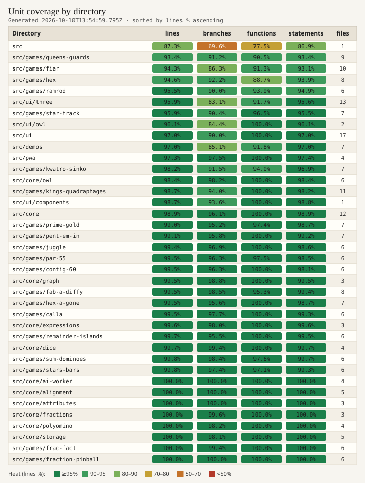

# Unit coverage heat map

**Task id:** `q-mp-693` (tip stamp **post949** → **post1059**; heat table still from last regenerate `q-mp-537` / suite **3280**; supersedes tip citation in `q-mp-537` / `q-mp-492` / `q-mp-442` / `q-mp-417` / `q-mp-336` / `q-mp-311` / `q-mp-286` / `q-mp-261`; wiki visual originally `q-mp-171`)
**Scope:** Dev / wiki visuals only — no `src/` product edits, no AI timing or player-facing copy changes.
**Canonical artifacts:** [`docs/dev/coverage-map.md`](../dev/coverage-map.md) + [`docs/dev/coverage-map.svg`](../dev/coverage-map.svg).

Per-directory vitest unit coverage (`json-summary`), sorted by **lines %** ascending so cold spots surface first. Live tip citation: `cursor/mp-tip-post1059` @ `890a9e3f` (tip-name/SHA prose only — no new inventory). Heat table below is from the last regenerate on tip `cursor/mp-tip-post949` @ `68f1548f` (stamp in the SVG title / generated-at line of the dev doc).

## Coldest directories (lines %)

Last regenerate measurement (38 directories under `src/`):

| Directory                 | Lines % | Branches % | Files |
| ------------------------- | ------: | ---------: | ----: |
| `src`                     |   87.25 |      69.64 |     1 |
| `src/games/queens-guards` |   93.42 |      91.17 |     9 |
| `src/games/fiar`          |   94.28 |      86.34 |    10 |
| `src/games/hex`           |   94.63 |      92.21 |     8 |
| `src/games/ramrod`        |   95.47 |      90.00 |     6 |
| `src/ui/three`            |   95.90 |      83.10 |    13 |
| `src/games/star-track`    |   95.91 |      90.36 |     7 |
| `src/ui/owl`              |   96.10 |      84.42 |     2 |

Repo-wide on that regenerate: **97.84%** lines (23385/23899), **93.33%** branches (11900/12750). Coverage vitest files then: **3280** (3278 passed | 2 skipped). Spec cited suite **3270** / **~13308**; regenerate after post949 UI/engine characterization folds was **3280** files / **13408** vitest-list cases (**13396** passed | **62** skipped under coverage = **13458**). Live tip for this stamp is `cursor/mp-tip-post1059` @ `890a9e3f` (unit-file / case counts move every fold — see [Development](./development.md)). Hex Hard stays **450ms**; no timing/threshold edits.

## Full heat table (SVG)



## Regenerate

```bash
npm run test:unit:coverage
npm run report:coverage-map
npm run check:dev-docs
```

Under coverage instrumentation, the local AI move-time mid-game bench can still emit **fab-a-diffy** / **fiar** / determinism `hardFlags` flakes. Do **not** change AI timing asserts or thresholds to silence those — note them in the PR instead (Hex Hard stays **450ms**). The last heat-table regenerate (post949) completed with EXIT 0 (no flakes). Accidental `docs/ai-move-time-*.md` churn from the coverage harness was restored and not committed.

## Related

- Dev map + regen notes: [`docs/dev/coverage-map.md`](../dev/coverage-map.md)
- Development commands: [Development](./development.md)
- CI unit budget / AI-bench skips: [CI unit budget](./ci-unit-budget.md)
